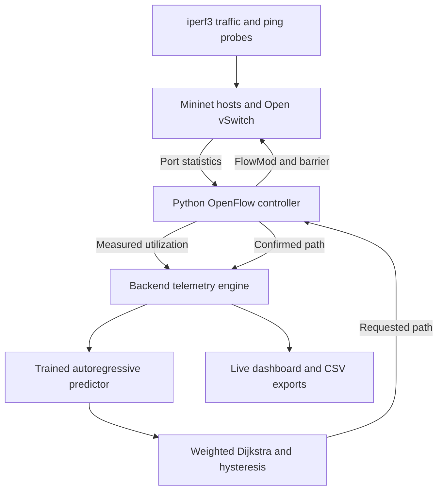

# Project explanation and architecture

## What to tell your professor

“Sir, humara project AI-Powered Adaptive Network Congestion Prediction and Routing hai. Hum Mininet mein virtual hosts aur switches banate hain, lekin unke beech actual packets travel karte hain. Controller OpenFlow counters se link utilization collect karta hai. Trained time-series model next five samples ka utilization predict karta hai. Prediction se link costs update hote hain, Dijkstra alternate route calculate karta hai, aur controller switches ke forwarding rules change karta hai. Hum static, reactive aur predictive routing ko latency, packet loss aur throughput ke basis par compare karenge.”

## Architecture

## CN concepts

- **Control/data-plane separation:** the Python controller chooses actions; switches forward packets.
- **OpenFlow 1.3:** controller handshake, port-statistics requests, FlowMod updates, and barrier confirmation.
- **Dynamic routing:** changing the H1–H2 path through S2 or S3.
- **Dijkstra:** lowest cost route in a weighted topology.
- **Traffic engineering:** link costs reflect measured or forecast congestion, beyond fixed shortest path.
- **Congestion management:** move a foreground flow away from a heavily used link.
- **QoS:** latency, throughput, loss, and jitter measurements.

This implements flow-level traffic engineering. It does not replace TCP congestion-control algorithms, implement OSPF, or claim ordinary OSPF automatically changes paths when queues grow.

## AI concepts

Supervised regression, sequence/window features, ridge regularization, held-out calibration, forecasting, classification by threshold, and evaluation. The model is trained by our project code; it is not an external pretrained language model. NumPy performs the linear algebra. LSTM was an initial option; this implementation chooses a smaller transparent model that can run on a student laptop. An LSTM extension would require separate implementation and evaluation, not just changing the model name.

## Why virtual networking is legitimate

Mininet is an emulator: Linux network namespaces isolate hosts, Open vSwitch forwards packets, and traffic-control settings enforce link characteristics. Packet measurements are real within that emulated environment. This allows repeatable CN experiments without buying routers. It does not establish performance on arbitrary physical networks.

## Demonstration sequence

1. Show Mininet mode and confirmed initial route.
2. Start a gradual-ramp experiment.
3. Show increasing measured link utilization and the forecast.
4. Show requested versus confirmed route and OpenFlow flow-table changes.
5. Show iperf3/ping results after the run.
6. Compare repeated baseline, reactive, and predictive runs.

## Limitations to explain honestly

Fixed topology and host pairs; no dynamic topology discovery, generalized ARP switching, controller high availability, production access control, or queue-occupancy measurement. A barrier establishes processing order but does not guarantee lossless route migration. The custom controller uses destination-based IPv4 rules and downstream-first updates; packets already in flight may still experience transient loss. Benefits depend on traffic patterns, model quality, and spare capacity.
